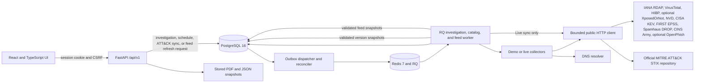

# CyberLens architecture and operations

CyberLens is a local, single-workspace security analysis and incident response application. The browser UI is a React single-page application. FastAPI provides the authenticated API. PostgreSQL stores workspace data; Redis and RQ carry investigation jobs to a separate worker.

## Runtime architecture

The API commits an investigation, its first attempt, and an outbox event in one PostgreSQL transaction. For due monitoring slots, the dispatcher commits a monitoring run, a separate investigation, its first attempt, and the outbox event together. A separate dispatcher publishes pending events to RQ using a stable per-attempt job ID; if it crashes after publishing but before marking the event delivered, it safely republishes the same ID. A periodic reconciler requeues old queued deliveries, fences stale running attempts, advances monitoring run history, and materializes due schedules. The worker atomically claims each attempt, checks its lease before persisting collector results, and stores a distinct collector run and evidence snapshot for each attempt. Findings remain attached to the stable parent investigation and are deduplicated across retries. The UI continues to poll the existing investigation API and saved reports retain their investigation IDs.

Automatic retries are limited to two per manual retry sequence and are scheduled only when collector evidence identifies transient network/provider failures. Delays grow exponentially from five seconds and cap at one minute. Missing credentials, denied provider access, invalid targets, and other permanent failures do not automatically retry. Local Demo fixtures keep their deterministic behavior, including the simulated provider-outage scenario; an operator can still use the existing manual retry action.

The RQ worker refreshes a Redis heartbeat on a dedicated thread, separate from job execution. `/health/live` reports API process liveness; `/health/postgres`, `/health/redis`, and `/health/worker` report each dependency independently; `/health/ready` requires all three. Worker readiness expires when the heartbeat stops refreshing.

## Existing product capabilities

- **Accounts and audit:** Argon2 password hashes, cookie-backed server sessions, CSRF checks, Redis-shared login throttling, session rotation after password changes, session revocation after administrator resets/deactivation, audited user/role changes, and a transactional tamper-evident audit chain. Audit events are append-only through ORM guards and database triggers. A configured first-admin bootstrap and last-active-admin protection remain in place. Viewers can read workspace data; Admins and Analysts perform protected writes, while user administration is Admin-only.
- **Assets and inventory:** normalized domain, IP, URL, email, and application records; software components; and expiring, revocable website authorization records checked by the worker before active website inspection.
- **Investigations:** PostgreSQL transactional outbox, idempotent Redis/RQ delivery, distinct attempt and collector histories, bounded transient retry with exponential backoff, stale-job recovery, evidence snapshots and hashes, finding deduplication, and saved comparisons.
- **Analysis sources:** synthetic demo scenarios; live DNS/RDAP with a registrable-domain lookup that retains the submitted hostname, bounded website/TLS/header observations, existing VirusTotal reports, explicit-address HIBP checks, optional explicitly authorized XposedOrNot community email lookup, NVD CPE/CVE candidates validated against selected software inventory, CISA KEV enrichment, and FIRST EPSS lookups for returned CVEs.
- **Review and response:** analyst applicability decisions, versioned risk explanations, immutable risk assessment revisions, sensitivity analysis, incident cases, status history, playbook task tracking, and PDF/JSON report snapshots.
- **Evidence graph and change radar:** a typed PostgreSQL projection connects captured assets, domains, IP addresses, certificates, software, CVEs, findings, investigations, incidents, and playbook tasks. Every stored edge has its own evidence foreign key, source, collector, observation time, direct/contextual classification, and Live/Demo mode. The graph is available as an interactive SVG with a keyboard-accessible relationship list. Investigation diffs distinguish new, changed, no-longer-observed, and unknown relationships; failed, partial, unavailable, or unrun collectors keep absence classified as unknown.
- **Controlled monitoring:** Admins and Analysts can schedule authorized website assets daily or weekly. The dispatcher creates a distinct saved investigation per occurrence, records the previous completed run for Change Radar, and uses the existing transactional outbox. Authorization is checked when scheduling and again before worker collection; expired or revoked authorization stops future runs. Provider failures remain unknown coverage.
- **Operations:** liveness/readiness endpoints, JSON log redaction, Alembic startup migrations, and guarded demo seed/reset commands.

Module 1 documents the baseline and adds engineering gates. Module 2 hardens identity and authorization while preserving Demo and Live workflows. Module 3 makes investigation delivery durable and records retries as separate attempts without changing the parent investigation API identifier.

Module 4 keeps collector provenance attached to each evidence snapshot. Live HTTP requests resolve and validate all A/AAAA answers, connect to a validated address, and share one monotonic deadline across DNS, connection, response reads, and redirects. A redirect is independently validated and pinned. Requests with provider credentials are limited to their intended HTTPS origin and cannot downgrade to HTTP. Website evidence records each redirect hop, the actual TLS SNI hostname, TLS version, negotiated ALPN (when selected), certificate subject/issuer/SANs/fingerprint, hostname match, and the exact endpoint used by the certificate trust check. The collector envelope records schema version, source/provider/version, observation time, status, freshness state, and any provider source timestamp.

Module 11 enriches NVD CVE candidates with FIRST EPSS score, percentile, provider result status, observation timestamp, source date, cache state, and freshness. Live lookups batch CVEs from each NVD page, use a provider-specific Redis cache and shared request cap, and send no API credentials. Demo mode stays offline with fixed synthetic EPSS values. CVSS, EPSS, CISA KEV, analyst applicability, and evidence remain separate. EPSS is informational and does not alter scoring; confirmed applicable CISA KEV findings keep the 90-point priority floor even when CVSS is unknown.

## Module 12 what-if remediation simulation

The investigation API offers evidence-grounded simulation options and a POST projection endpoint. Supported actions cover an applicable CVE, observed web security-header gaps, expired or hostname-mismatched certificates, relevant SPF/DMARC issues, validated direct reputation findings, and verified breach-related findings. The service requires a finished investigation, applicable target finding, matching saved evidence from a successful collector, and action-specific evidence fields. The API includes the selected finding/evidence, baseline and projected score and category values, policy version, and explicit assumptions.

Simulation reuses `score_records` under the current `cyberlens-academic-1.0` policy and removes only the selected finding from an in-memory list. It uses the coverage statuses recorded with the current assessment where available, and otherwise selects the latest collector status in stable attempt order so the baseline matches saved coverage. It does not create a simulation record or write to investigation, finding, evidence, assessment, report, incident, or task tables. It is a scenario estimate, not proof that remediation has been applied; a subsequent investigation is needed to update saved risk. Module 13 adds separately tracked remediation plans and actions alongside the existing playbook tasks.

## Module 13 remediation plans and security-control mapping

Remediation tracking is a separate analyst workflow over saved findings, incidents, and playbook tasks. PostgreSQL stores plans, child actions, and finding-to-control mappings. These records reference (but do not rewrite) findings, evidence snapshots, incidents, playbook tasks, and immutable risk/report snapshots. The versioned security-control catalog is maintained locally in code; mapping rationale and confidence are analyst-entered and are not automatic compliance determinations.

Plans and actions support proposed, planned, implemented, validated, rejected, and not-applicable states. An action or finding-control mapping cannot enter `validated` without a saved evidence snapshot from the same investigation as its linked finding (or linked incident investigation for a plan without a finding). Validation records the evidence ID, actor, and time. Writes require Analyst or Admin plus normal CSRF/session checks; Viewers can inspect the catalog, plans, and mappings. Creation and update events are stored in `audit_events`.

Newly generated investigation and incident reports snapshot remediation plans, actions, mappings, catalog version, and verification evidence references. Existing saved report snapshots and bytes remain immutable. Remediation state does not change finding applicability or risk assessments; a follow-up investigation is still required to reassess observed risk.

## Module 18 security posture scorecard

The authenticated `GET /api/v1/posture/scorecard` endpoint builds a read-only projection from saved PostgreSQL assets, completed/partial investigations, immutable risk revisions, findings, provider collector runs/evidence, incidents and transition events, monitoring history, and finding-control mappings. It adds no stored score, migration, graph service, provider call, or background job. Admins, Analysts, and Viewers can read it; only Admins and Analysts can create an immutable posture report through `POST /api/v1/reports/posture`.

Each metric includes a time window, scope, state (`available`, `partial`, `stale`, `unavailable`, or `empty`), and an explanatory note. Risk is the equal-weighted mean of each asset's latest in-window investigation assessment with a numeric score; coverage uses per-asset-kind expected categories and counts missing coverage rather than treating it as safe. Trend buckets omit periods without records. Provider state uses the most recently saved collector result, while freshness is evaluated against the selected window; it is not a live health probe. PDF/JSON exports store the exact scorecard response inside a new report snapshot, leaving prior report content unchanged.

Findings do not currently have an open/closed lifecycle. The scorecard therefore labels unique high/critical findings in each asset's latest observation, not verified open or unresolved findings; `open_high`, `open_critical`, and `open_total` remain null with `open_counts_available=false`. Incident timings use saved status-transition events only. Rejected/not-applicable control mappings are excluded from active mapping coverage and only evidence-backed validated mappings count as validated coverage. These figures do not imply control effectiveness or compliance.

## Module 25 CINS Army corroborating IP evidence

CINS Army is a second fixed source inside the existing shared threat-feed snapshot system. Its public text feed is parsed into exact canonical IP records using the shared PostgreSQL snapshot, refresh attempt, dispatcher, worker, bounded safe HTTP, checksum, retention, and atomic activation lifecycle. It has an independent per-source refresh cooldown, configured to 24 hours by default; this is CyberLens configuration and does not describe provider update frequency. An investigation pins the CINS snapshot on its `cins_army` collector run and matches only an explicitly submitted public IP locally. No outbound request is made to the investigated IP.

The IP detail/report projection groups CINS, Spamhaus, and VirusTotal observations while preserving each source's evidence ID, source, observation time, status, and snapshot reference. Only CINS and Spamhaus count as address-list sources for the “Listed by two sources” label; overlap does not increase severity. A no-longer-listed event requires a later successful observation on a different validated snapshot. Stale/failed refreshes remain unknown. A later absence does not prove remediation. The provider supplies no per-indicator score, attack category, count, or first-seen timestamp, so these values are not inferred. Demo uses reserved synthetic addresses and keeps all providers offline.

## Module 26 optional OpenPhish URL evidence

OpenPhish uses the fixed official public feed URL discovered from the [provider repository](https://github.com/openphish/public_feed). A distinct `openphish` collector reuses the existing shared refresh attempt, dispatcher, RQ worker, bounded DNS-pinned HTTPS client, checksum, snapshot retention, and atomic activation. Refresh defaults to every 12 hours as CyberLens configuration; the interval does not make a claim about provider publication frequency. The worker parses URL text records into PostgreSQL and never visits a feed-listed destination. Investigations pin a validated snapshot and match only locally.

Matching normalizes scheme/hostname and IDNA consistently, while retaining exact path case, query, fragment, and encoded reserved characters. A fresh full-URL match yields a medium `needs_review` candidate; only an analyst decision of `applies` can affect the existing risk policy. Same-host evidence without an exact full URL is contextual. Legacy URL assets remain in the database, but are marked as incomplete because older versions removed query strings and fragments; an Analyst/Admin must confirm the saved full URL before direct matching. Invalid credentials in URLs are rejected with generic errors.

The current [OpenPhish terms](https://www.openphish.com/terms.html) limit the community feed to qualifying personal/research use; organization business/security operations and third-party disclosure need prior written permission. Live ingestion is disabled by default, and a separate operator setting is required to attest that shared use has provider permission. Without that permission, Live access is restricted to one configured owner across APIs, findings, evidence, history, integrations, reports, and downloads for as long as provider-derived data is retained. Turning the feature off does not lift an existing source restriction. The setting records operator intent only and cannot grant rights. Demo uses reserved synthetic fixtures and never requests the provider.

The community feed contains URL strings without per-indicator confidence, brands, discovery times, or observation times. A no-match means only that the saved snapshot did not contain the exact URL. Stale or invalid snapshots produce unknown coverage. Report snapshots name the source and use restrictions, but do not copy feed lines. See [OpenPhish operation and privacy](openphish.md).

## Module 7 performance and analyst workflow

Collection routes keep their existing JSON list bodies and add stable, one-based pagination metadata in `X-Total-Count`, `X-Page`, `X-Page-Size`, and `X-Has-Next` headers. Assets, findings, investigations, incidents, reports, and audit events accept explicit filters plus a constrained sort column and order; every ordered query includes its primary-key tie breaker. The frontend has a small generated operation client layered over the committed FastAPI OpenAPI types, so list requests and responses stay tied to the backend contract.

List serializers batch related assets, users, website authorizations, software components, risk rows, and latest attempts. Incident detail assembly batches linked findings, event actors, and task completion users. These paths avoid per-row lookups while preserving the existing response shapes and report snapshots. No new database or graph store is introduced, and Module 7 requires no schema migration.

The React entry point now delegates overview, asset, investigation, incident, report, integration, and administration screens to feature modules. Shared page titles, empty states, status badges, loading/error states, route helpers, and generated API operations are reusable. Hash deep links cover assets, investigations, findings, incidents/remediation, reports, and comparison entry points. Investigation detail polling cancels in-flight requests on navigation, retries transient request failures with bounded exponential delays, and stops after a terminal status. Form drafts reset when the selected record changes; task saves submit the selected draft status and notes.

The overview includes a Recharts risk-history line chart when scored investigations exist. Keyboard focus rings, form labels, live status regions, responsive layout rules, and an accessible list alternative for graph relationships remain available to keyboard and narrow-screen users. Playwright coverage includes startup/login, labels and focus, deep links, and role-based control visibility. The Module 10 workflow test provisions Analyst and Viewer accounts in the UI and exercises a complete analyst case flow; it runs against a fresh CI Demo stack.

## Module 14 threat-modeling workspace

Asset criticality, data classification, trust zone, exposure, business owner, and protection requirements are stored as analyst-maintained business context. Unknown classifications remain explicit. STRIDE scenarios are separate from findings and technical risk assessment rows. Each scenario records likelihood, business impact, confidence, assumptions, unconfirmed information, owner, review status, and optional same-asset links to a finding, investigation, or incident. The displayed business-impact scenario priority is the transparent product of likelihood and business impact; confidence does not alter it, and this value is never combined with technical severity or version 1 risk scoring.

The threat-model API permits writes to Admins and Analysts, reads to authenticated roles, and records asset-context/scenario changes in the audit log. Newly generated investigation and incident reports snapshot threat scenarios; saved report snapshots and bytes stay unchanged. Demo mode continues to use its current offline findings and investigations; threat scenarios are analyst-entered workspace data.

## Module 15 MITRE ATT&CK mapping

The API originally served the checked-in Enterprise subset at `/api/v1/attack/catalog`. PostgreSQL stores each mapping against exactly one finding or incident and requires a saved evidence snapshot linked to that target. A curated rule can suggest T1190 for an analyst-confirmed applicable vulnerability on an internet-facing asset, or T1589.002 for historical email breach exposure. These are contextual candidates; exposure alone does not establish the ATT&CK behavior. `confirmed_incident` only makes candidates from linked findings available and never maps a technique by itself. Admins and Analysts can propose, approve, reject, or override mappings. Technique IDs and tactics are validated against their saved catalog version. Existing reports remain immutable snapshots.

## Module 20 versioned MITRE ATT&CK synchronization

`attack_catalog_versions` stores the bundled legacy subset, imported Enterprise catalog snapshots, and synchronization status records. The forward-only `20261019_0015` migration seeds the exact checked-in subset as `cyberlens-attack-enterprise-subset-1.0` and makes it active; existing mapping rows retain their version and stored technique name. In Live mode, an Admin-only, CSRF-protected API action inserts a durable pending record. The existing dispatcher delivers it to the existing RQ worker with a stable job ID. The worker resolves the official GitHub commit, reads the repository index at that commit, and fetches only the corresponding versioned Enterprise bundle at the same commit through the bounded DNS-pinned client. It never follows redirects and never fetches URL properties embedded in STIX content. Demo mode rejects the API request and the worker has a second no-network guard.

Only STIX 2.1 Enterprise tactics, attack patterns, and `subtechnique-of` relationships are imported. Required IDs, ATT&CK external IDs, tactic references, parent links, lifecycle flags, timestamps, and source references are validated. Revoked/deprecated records remain in their immutable catalog snapshot with `selectable=false`; active mappings and reports retain their prior text/version. The importer stages normalized content before one transaction changes the active version. Failed or incomplete imports never remove the existing active catalog. Release plus SHA-256 makes repeated imports idempotent, while an active-row partial unique index and transaction locking guard concurrent activation. The checksum detects later content changes but is not independent proof of source authenticity or forensic authenticity.

## Module 16 audit and evidence integrity

Every normal `AuditEvent` insert receives a one-based sequence and a canonical SHA-256 over the previous hash, actor, action, entity, UTC event time, and metadata. The chain-head row is updated in the same SQL transaction. PostgreSQL uses a row lock to serialize appends across processes; a process-local lock also orders thread-based Demo/SQLite writes. A forward-only migration backfills existing audit events in timestamp/ID order. SQLAlchemy rejects ordinary ORM updates/deletes, and PostgreSQL/SQLite triggers reject database updates/deletes. `GET /api/v1/integrity` and `/audit-chain` verify sequence continuity, links, event hashes, and the stored head. Evidence endpoints recompute SHA-256 over canonical saved evidence JSON. The JSONL audit export is restricted to Admin/Analyst.

The UI shows `verified`, `failed`, `unavailable`, and `incomplete` states plus stored/calculated evidence checksums. New PDF/JSON reports snapshot the audit-chain and referenced-evidence results; existing report bytes and snapshots are unchanged. Checksums detect later changes to stored content but do not prove forensic authenticity, collection provenance, or chain of custody. No external WORM anchor, signing key, or independent chain-of-custody service is configured. A privileged database operator able to rewrite the events, head, and triggers can reconstruct the chain, so this is tamper-evident within the configured application boundary, not cryptographic authentication against the database administrator.

## Module 17 controlled continuous monitoring

Monitoring schedules are attached to one domain or URL asset, the exact unexpired and unrevoked `WebsiteAuthorization` row, the creating user, and the operating mode in which the schedule was created. A Demo schedule cannot be promoted into Live checks when the application changes modes. Daily and weekly cadence values are UTC intervals. The dispatcher selects due schedules with a row lock, inserts a unique `(schedule, scheduled_for)` run, and creates a new ordinary investigation, attempt, and outbox row in the same database transaction. Duplicate scheduler cycles therefore do not create another run for that slot. A delayed dispatcher runs one overdue slot and moves the next date forward past missed intervals to avoid a backlog burst.

Each monitoring occurrence is a separate saved investigation; previous investigation records, evidence, findings, comparisons, and reports are not rewritten. The run history links each investigation to the prior completed/partial investigation, and the Change Radar route calls the existing evidence comparison projection. Failed or unavailable providers remain unknown coverage. Pausing and cancelling stop future schedule dispatch; a run already queued or running is allowed to finish, except that the worker stops it if its linked authorization is no longer active. Failed schedules can be resumed only when an active authorization is available. Demo mode retains offline synthetic collectors, and no containment or external notification path is called.

## Dependencies and supported runtimes

The backend package is declared in `backend/pyproject.toml`, with pinned Python packages in `backend/requirements.lock`. The backend Docker image uses Python 3.12; the package declares Python 3.11 or newer. Direct backend dependencies are:

- FastAPI and Uvicorn for the HTTP API.
- SQLAlchemy, Alembic, and psycopg for persistence and PostgreSQL migrations.
- Pydantic Settings for environment configuration.
- Redis and RQ for job queuing.
- argon2-cffi for password hashing; `cryptography>=50.0.2,<51.0.0`, `certifi>=2026.10.19`, and dnspython for TLS/DNS checks.
- httpx and publicsuffix2 for bounded HTTP and domain handling.
- ReportLab and `Pillow>=13.0.0,<14.0.0` for reports; `pytest>=9.0.3,<10.0` for tests.

The frontend uses Node 22 in its Docker image, React 18, TypeScript 5, Vite 7, Recharts 2, and generated OpenAPI route types. Its exact npm dependency graph is committed in `frontend/package-lock.json`. `@playwright/test` is a development dependency for startup/login, keyboard/accessibility, deep-link, and role workflow checks.

Compose uses `postgres:16-alpine` and `redis:7-alpine`. `docker-compose.yml` builds the API, RQ worker, outbox dispatcher, and UI from the Python backend and Node frontend images. Runtime API dependencies and the frontend dependency tree are installed from their respective lockfiles.

## Database and migrations

The data model is defined in `backend/app/models.py`; its current tables are catalogued in [the data model guide](data-model.md). Revisions `20261011_0001` through `20261019_0014` add workspace, investigation, authorization, graph, risk-revision, EPSS, remediation, threat-model, ATT&CK-mapping, audit-integrity, monitoring, and OSV inventory structures. Revision `20261019_0015` adds versioned ATT&CK catalog snapshots/status and seeds the legacy subset without rewriting mappings or reports. Revision `20261019_0016` adds time-limited XposedOrNot authorization and provider selection fields. Forward-only revision `20261020_0017` adds shared threat-feed source, immutable content snapshots, CIDR records, refresh attempts, and a nullable feed snapshot pin on collector runs; `20261020_0018` adds CINS exact-IP typing and source identity; `20261020_0019` adds exact URL snapshot rows, a source owner reference, and the explicit URL-retention-complete flag. These migrations do not rewrite old investigations or reports. Compose runs `alembic upgrade head` before bootstrap and API startup. Clean-PostgreSQL CI applies all revisions to a fresh service database and runs `alembic check`; local migration tests use disposable SQLite databases.

## Shared Spamhaus DROP snapshots

Live feed refreshes are initiated by the scheduled dispatcher or an Admin's CSRF-protected Integrations action. A durable refresh attempt is separate from immutable, content-addressed snapshots. The dispatcher gives RQ a stable job ID; a worker makes bounded requests only to the two fixed Spamhaus URLs through the DNS-pinned client, with TLS verification, redirects disabled, conditional validators, a shared deadline, and response-size caps. It validates both IPv4 and IPv6 JSON-lines payloads before one transaction installs network rows and flips the source's active snapshot pointer. An error records an attempt status while leaving the last validated snapshot and its revalidation time untouched. The refresh interval cannot be set below 24 hours.

Investigations never call Spamhaus. A worker reads the PostgreSQL snapshot when starting the `spamhaus_drop` collector, verifies its canonical content checksum, and records the snapshot ID on that CollectorRun before matching only the explicit public IP asset. CIDRs are parsed and matched with IP arithmetic; networks are never expanded into addresses. Each finding starts at medium severity and `needs_review`; only an analyst applicability decision can make it contribute to the existing reputation category in risk policy v1. Missing, stale, failed, or checksum-invalid snapshots remain unavailable/unknown coverage. Demo mode uses reserved example ranges in a bundled synthetic fixture and sends no provider request.

Snapshot metadata preserves the provider publication timestamp, copyright notice, attribution, retrieval time, feed URLs, record count, and parser version. The SHA-256 is over CyberLens's canonical parsed snapshot representation; it detects stored content change and does not independently prove provider authenticity. Spamhaus describes DROP as a limited advisory dataset, requires attribution/date/copyright retention, and asks automated clients not to download more than once per day; follow its [official documentation](https://www.spamhaus.org/blocklists/do-not-route-or-peer/) and [Fair Use Policy](https://www.spamhaus.org/blocklists/drop-fair-use-policy/). Operational details are in [spamhaus-drop.md](spamhaus-drop.md).

Revisions `20261017_0009` and `20261017_0010` add remediation workflow tables, asset threat context, and STRIDE scenario records. The latter backfills existing assets with explicit `unknown` business classifications and does not rewrite existing report snapshots or risk assessments. These additions remain separate from the technical risk scorer.

The second migration uses `Base.metadata.create_all` rather than listing each table operation. That is suitable for the current initial schema, but future schema changes should be written as explicit incremental migrations; otherwise an old database cannot infer a historical model snapshot from the current metadata.

Backend unit tests use an in-memory SQLite database. They validate application workflows but do not replace the clean-PostgreSQL migration job.

## Configuration and startup

1. Install Docker Desktop and start its engine.
2. Create `.env` from `.env.example` only when `.env` does not already exist. The file is ignored by Git and holds local configuration and optional provider keys.
3. Configure non-default database, Redis, and first-admin secrets in `.env` and run `docker compose up --build` for local Live mode. For isolated offline Demo mode, add `--project-name cyberlens-demo -f docker-compose.yml -f docker-compose.demo.yml` to the Compose command.
4. Compose waits for PostgreSQL and Redis health. The API applies Alembic migrations, runs the initial-admin bootstrap, and starts Uvicorn. The dispatcher publishes and reconciles investigation jobs, and the worker consumes RQ jobs while refreshing its heartbeat. The frontend starts after API liveness passes; aggregate readiness remains available for operator checks.
5. Open `https://localhost:8443`; API docs are at `/docs`. The local gateway terminates HTTPS with Caddy's persisted internal certificate and binds only to loopback. Health routes are `/api/v1/health/live`, `/api/v1/health/postgres`, `/api/v1/health/redis`, `/api/v1/health/worker`, and aggregate readiness `/api/v1/health/ready`.

The main settings are `APP_MODE`, `APP_NAME`, `LOG_LEVEL`, `API_CORS_ORIGINS`, `DATABASE_URL`, `REDIS_URL`, `REDIS_PASSWORD`, `BOOTSTRAP_ADMIN_USERNAME`, `BOOTSTRAP_ADMIN_PASSWORD`, and `COOKIE_SECURE`. `HIBP_API_KEY`, `VIRUSTOTAL_API_KEY`, and `NVD_API_KEY` are optional backend-only provider credentials; the keyless HIBP Pwned Passwords range lookup uses no additional setting, and `HIBP_API_KEY` remains for explicit email-breach queries. The separately disabled XposedOrNot community lookup requires `XPOSEDORNOT_ENABLED`, `XPOSEDORNOT_COMMUNITY_USE_ACK`, and an encryption/HMAC `XPOSEDORNOT_CACHE_KEY`; it uses shared Redis for its encrypted short-lived cache and endpoint limits. Compose sets the container database and Redis URLs; local development can override them through environment variables. Demo mode uses synthetic collector fixtures, offline password-screening/XposedOrNot results, and sends no external requests. The initial Demo admin must change its temporary password at first sign-in. Live bootstrap requires a configured password of at least 12 characters and rejects the published Demo password; an existing administrator is not reset by changing the bootstrap variable. New passwords are screened after submission; existing-password login does not call HIBP.

## Release and operations hardening

The default Compose stack is Live. Only the HTTPS gateway publishes a host port, on `127.0.0.1:8443`; API, frontend, worker, dispatcher, PostgreSQL, and Redis communicate over the Compose network. The frontend image builds Vite assets and serves them from an unprivileged Nginx image, while API and gateway containers use unprivileged users. The isolated Demo overlay uses a separate Compose project and distinct named volumes. The normal Live project retains existing PostgreSQL and Redis volumes; no startup path deletes or recreates volumes.

Live settings reject the published database password, require a non-empty Redis password (or a password-bearing Redis URL), and require `COOKIE_SECURE=true`. The first administrator still comes from the existing bootstrap command and must have an operator-chosen password. If an existing PostgreSQL volume has the prior Demo role password, it needs an in-place role-password rotation before its new Live connection URL can authenticate. Demo keeps the synthetic, no-network workflow in its separate Compose project. Live workspace queries hide Demo-provenance data while retaining the stored row provenance; old saved report bytes are not rewritten.

Every API response receives an `X-Request-ID`; JSON logs include that ID, selected operational fields, and redacted secret values. The API exposes separate liveness/readiness routes plus an authenticated `/api/v1/metrics` snapshot for request totals, queue depth, job duration, worker heartbeat TTL, and provider status. Compose probes API liveness, PostgreSQL, Redis authentication, worker heartbeat expiry, the frontend, and the local gateway separately.

CI audits locked Python and Node dependencies, scans the source tree and built images with Trivy, and publishes a CycloneDX repository SBOM. `scripts/backup-postgres.ps1`, `scripts/restore-postgres.ps1`, and `scripts/test-restore.ps1` exercise custom-format PostgreSQL backup and disposable-database restore without deleting existing volumes.

These controls improve local release confidence. They do not establish public-production readiness: TLS termination, external secret management, HA/failover, alert routing, retention policy, and an independently operated metrics/SBOM service remain deployment responsibilities.

## Module 10 benchmark and engineering documentation

`benchmarks/datasets/demo_scenarios.json` manifests the five existing CLI-seeded synthetic scenarios. `scripts/run-benchmark.ps1` verifies `APP_MODE=demo` before it calls additive `seed-demo`; the Python harness also verifies a loopback IP, Demo mode, and worker readiness before creating one investigation and JSON report per scenario. It does not reset or delete workspace records. The harness records p50/p95/p99 API response latency, attempt queue wait/duration, investigation retry/failure rates, collector availability, repeated finding signatures, report generation time, runtime metrics, hardware/configuration/date, and process/container resource snapshots where available. Results contain measured values only and exclude proposed targets.

The benchmark adds no database tables or changes to existing resources. Benchmark IDs, timestamps, and reports use the same persistence path as interactive Demo workflows. Migration-upgrade CI runs legacy SQLite upgrade fixtures that verify saved records survive revisions to head; the clean PostgreSQL job remains a separate check. Playwright CI now exercises administrator role provisioning, an Analyst asset/investigation/case/timeline/playbook/report workflow, comparisons and deep links, then verifies Viewer read-only behavior. Disposable backup restoration compares row counts for core saved-record tables without removing named volumes.

Further detail is in [benchmark methodology](benchmarks.md), [setup instructions](setup.md), [API guide](api.md), [threat model](threat-model.md), and [known limitations](known-limitations.md).

## Optional AI briefing status

Evidence-grounded AI case briefings are disabled. There is no local model runtime or inference package installed/configured, and the repository does not send saved evidence, findings, comparisons, or analyst notes to a model service. `httpx` being available is not sufficient operational support for an unconfigured inference service. Investigation, graph, comparison, and incident workflows remain deterministic and unchanged. See [`docs/ai-briefing.md`](ai-briefing.md) for the inspection result, privacy rationale, and requirements before reconsidering the feature.

## Local engineering checks

Run `./scripts/verify.ps1` in PowerShell for backend tests, frontend lockfile installation, frontend TypeScript checks, frontend production build, and Compose configuration validation. Use `-SkipDependencyInstall` when `frontend/node_modules` is already installed and the lockfile install is not needed.

The GitHub Actions workflow in `.github/workflows/ci.yml` runs the same code checks plus clean PostgreSQL migration validation, legacy SQLite migration-upgrade checks, and Playwright startup/login and analyst/viewer workflow flows against a newly built Compose stack.

## Trust boundaries and known limits

FIRST EPSS lookups use the public API as a CVE batch, a provider-specific six-hour Redis cache, and a shared limit of 60 uncached requests per minute. No key is sent. EPSS estimates exploitation likelihood; it is not evidence of exploitation or compromise and does not affect risk scoring. Missing scores and provider errors remain explicit. An applicable KEV finding keeps the 90-point risk floor even if CVSS is unavailable.

- Live HTTP(S) uses credential-free GET requests, checks every A/AAAA answer against public-address policy, pins connections to validated addresses, caps response bytes, and enforces one cancellable deadline across DNS, connection, body reads, and redirects. Each redirect is resolved and validated again. Credentialed provider requests are restricted to the intended HTTPS origin and cannot downgrade to HTTP.
- Live website checks require an unexpired, unrevoked authorization record. The worker verifies the record before inspection. The check is a bounded GET and selected TLS/certificate/header observation, not a complete protocol or cipher audit. Certificate trust status is tied to the verified request's final URL and TLS hostname; if those differ from the certificate-inspection request, trust for the captured certificate is recorded as unverified.
- Only existing VirusTotal URL reports are queried. URL query strings and fragments are removed for reputation lookups; paths retain case. VirusTotal IPs use its IP-address endpoint. Provider credentials are scoped to the NVD, VirusTotal, or HIBP origin that owns them. HIBP checks a registered email address and does not enumerate a domain. NVD CPE selections must match the inventory vendor, product, and exact version and are audited. NVD candidates require analyst applicability review before affecting vulnerability risk.
- Demo fixtures are synthetic. Live results depend on public data, network access, rate limits, provider service availability, and account entitlements.
- Login throttling depends on Redis availability and uses the shared Redis service, so failed authentication returns `503` while Redis is unavailable. Legacy website authorizations preserve their recorded note/time and remain active for a 30-day migration grace period; they must be renewed after that. The application is intended for one local shared workspace; multi-tenant isolation, high availability, public deployment hardening, evidence uploads, automated containment, and external notifications are out of scope.
- The outbox is durable in PostgreSQL, but Redis remains the delivery transport and must be available for work to execute. A Redis heartbeat indicates that an RQ worker is alive, not that an external provider is available. Stale running work may repeat read-only collectors as a new, separately recorded recovery attempt; late results from the fenced attempt are discarded.
- Risk is an academic prioritization aid, not a probability of compromise or a validated industry metric. Evidence hashes detect content changes but do not prove provenance or chain of custody.
- Risk policy `cyberlens-academic-1.0` remains the version 1 behavior: the scorer accepts explicit finding, collector-status, and provenance records, deduplicates by finding fingerprint, uses the highest applicable severity per covered category, applies the documented floors, and records the exact contributors. Missing or unavailable coverage is excluded and described as unknown; it never becomes a safe result. NVD vulnerability candidates start as `needs_review`, and only an analyst decision of `applies` affects the vulnerability category. Each changed input set creates an immutable `risk_assessment_revisions` row; existing report snapshots are not rewritten. Sensitivity output shows the effect of varying one category weight by ±20%. No calibration claim is made because the workspace has no labeled incident outcome set.

## Module 22 XposedOrNot community email-breach lookup

XposedOrNot is a distinct optional source, disabled by default and never substituted for HIBP. The official community API documentation (quick reference last updated 03-Jun-2026) describes `/v1/check-email/{email}`, the optional `details` query, and free per-IP/per-endpoint caps of 2 requests/second, 25/hour, and 100/day. It describes the community API as personal/low-volume use and directs those building a product on breach data or needing more throughput to its paid offering. Operators must determine that their use is permitted before acknowledging/enabling this setting; CyberLens does not attempt to bypass those restrictions. See [provider terms, coverage, privacy, and setup](xposedornot.md).

An Analyst/Admin selects XposedOrNot for one registered email investigation and confirms authorization to send that exact address. The grant is tied to the email asset and provider, expires after 30 days, is revocable, audited without the address in event metadata, and is rechecked by the worker immediately before collection. The collector makes one HTTPS GET to the documented basic endpoint with its documented `details=true` option, with a 256 KiB cap and the existing safe outbound DNS/TLS/deadline controls. No analytics/domain endpoint or second request is used. Unknown per-record verification stays unknown; only explicitly provider-verified breach records create the historical-exposure finding. Provider scoring fields are discarded. No-match is displayed as “No record found in this provider's dataset.” and does not imply safety.

Successful/no-match responses are normalized to allowlisted IDs, names, dates, exposed-data categories, verification metadata, source, and observation time. Descriptions, email echoes, counts that are not needed, password details, and raw response bodies are discarded. Results are cached for 15 minutes by default (configurable from 60 to 3600 seconds) using a keyed email digest and Fernet-encrypted cache content. One shared Redis rolling-window limiter reserves requests against the provider's 2/25/100 caps using Redis server time; it fails closed when Redis is unavailable, and a provider 429 is not retried. Separate deployments do not share the Redis quota and operators must keep their total egress within the provider's per-IP cap. Demo uses deterministic synthetic findings and no network request. Risk scoring keeps source evidence separate, while the version 1 highest-per-category rule prevents a second email-breach finding from increasing the same category score.

## Module 19 OSV package vulnerability analysis

An Analyst/Admin may record an optional ecosystem and normalized package name on an existing `SoftwareComponent`; the component's explicit version is required for OSV lookup. npm names are normalized to lowercase while PyPI names use PEP 503 dash normalization. Existing CPE/vendor/product records remain intact and continue through the NVD collector. No dependency is inferred from an asset identifier or website.

Application investigations add the OSV collector to the existing durable attempt and outbox flow. For each selected package/version it sends a JSON `POST /v1/query` request through the existing DNS-pinned outbound client, preserving TLS verification, public-address checks, response limits, request deadlines/cancellation, and restricted redirect handling. The body contains only ecosystem, normalized name, explicit version, and a server-returned page token. The bounded collector checks at most 20 package rows, three pages per package, 3,000 distinct advisories, and 2 MB per response; reaching a bound is shown as partial coverage. Complete results and no-match results use a package-specific six-hour cache and shared Redis request limit. The adapter makes at most one short retry per page for transient network and 5xx errors; the existing orchestration may then schedule its bounded exponential-backoff retry for transient evidence. Quota-limited, failed, unavailable, and partial statuses remain visible. Demo uses one bundled synthetic match for `npm/cyberlens-demo-widget@1.0.0` and never contacts OSV.

Every returned advisory is stored in the existing evidence snapshot with provider/version, observation/freshness, advisory aliases and timestamps, affected ranges, fixed versions, references, severity metadata, withdrawal state, and component ID. Non-withdrawn matches create `needs_review` findings linked to that evidence. The risk policy remains unchanged: unknown severity is not scored, and only analyst-confirmed `applies` records can contribute. Explicit CVE aliases correlate OSV and NVD records only for the same component for duplicate-risk suppression; neither source record nor prior report snapshot is discarded. Local verification uses deterministic fixtures; live OSV availability, quota behavior, and current upstream records were not measured.
