# Database data model

SQLAlchemy records live in `backend/app/models.py`; Alembic imports that metadata in `backend/alembic/env.py`. The schema currently contains 35 tables.

## Relationship map

```mermaid
erDiagram
  USER ||--o{ SESSION : authenticates
  USER ||--o{ ASSET : registers
  ASSET ||--o{ WEBSITE_AUTHORIZATION : scopes
  USER o|--o{ WEBSITE_AUTHORIZATION : manages
  ASSET ||--o{ EMAIL_BREACH_AUTHORIZATION : scopes
  USER o|--o{ EMAIL_BREACH_AUTHORIZATION : authorizes
  ASSET ||--o{ SOFTWARE_COMPONENT : inventories
  ASSET ||--o{ INVESTIGATION : analyzed_in
  USER ||--o{ INVESTIGATION : requests
  ASSET ||--o{ MONITORING_SCHEDULE : monitors
  WEBSITE_AUTHORIZATION ||--o{ MONITORING_SCHEDULE : authorizes
  USER ||--o{ MONITORING_SCHEDULE : owns
  MONITORING_SCHEDULE ||--o{ MONITORING_RUN : records
  INVESTIGATION ||--o| MONITORING_RUN : scheduled_investigation
  INVESTIGATION o|--o{ MONITORING_RUN : previous_comparison
  INVESTIGATION ||--o{ INVESTIGATION_ATTEMPT : attempts
  INVESTIGATION_ATTEMPT ||--o| INVESTIGATION_OUTBOX : delivery_intent
  INVESTIGATION_ATTEMPT ||--o{ COLLECTOR_RUN : executes
  THREAT_FEED_SOURCE ||--o{ THREAT_FEED_SNAPSHOT : versions
  THREAT_FEED_SOURCE o|--|| THREAT_FEED_SNAPSHOT : active_snapshot
  THREAT_FEED_SNAPSHOT ||--o{ THREAT_FEED_NETWORK : stores
  THREAT_FEED_SOURCE ||--o{ THREAT_FEED_REFRESH_ATTEMPT : refreshes
  THREAT_FEED_SNAPSHOT o|--o{ COLLECTOR_RUN : pinned_by
  INVESTIGATION ||--o{ COLLECTOR_RUN : aggregates
  INVESTIGATION ||--o{ EVIDENCE_SNAPSHOT : captures
  COLLECTOR_RUN ||--o{ EVIDENCE_SNAPSHOT : produces
  EVIDENCE_SNAPSHOT ||--o{ EVIDENCE_RELATIONSHIP : supports
  INVESTIGATION ||--o{ EVIDENCE_RELATIONSHIP : projects
  INVESTIGATION ||--o{ FINDING : reports
  ASSET ||--o{ FINDING : concerns
  EVIDENCE_SNAPSHOT ||--o{ FINDING : supports
  INVESTIGATION ||--o| RISK_ASSESSMENT : scores
  INVESTIGATION ||--o{ RISK_ASSESSMENT_REVISION : revises
  ASSET ||--o{ INCIDENT : has_case
  ASSET ||--o{ THREAT_SCENARIO : models
  FINDING o|--o{ THREAT_SCENARIO : contextualizes
  INVESTIGATION o|--o{ THREAT_SCENARIO : contextualizes
  INCIDENT o|--o{ THREAT_SCENARIO : contextualizes
  INVESTIGATION ||--o{ INCIDENT : informs
  INCIDENT ||--o{ INCIDENT_FINDING : links
  FINDING ||--o{ INCIDENT_FINDING : selected
  FINDING o|--o{ ATTACK_MAPPING : maps
  INCIDENT o|--o{ ATTACK_MAPPING : maps
  EVIDENCE_SNAPSHOT ||--o{ ATTACK_MAPPING : supports
  INCIDENT ||--o{ INCIDENT_EVENT : records
  INCIDENT ||--o{ PLAYBOOK_TASK : tracks
  INCIDENT ||--o{ REPORT : snapshots
  INVESTIGATION ||--o{ REPORT : snapshots
  USER ||--o{ INCIDENT_EVENT : authors
  USER ||--o{ REPORT : generates
  USER ||--o{ AUDIT_EVENT : performs
```

## Table catalogue

| Table | Purpose and key links |
| --- | --- |
| `workspace_metadata` | Shared key/value workspace and schema-generation metadata. |
| `users` | Usernames, optional email, Argon2 password hash, role, activation and first-login password-change flags. |
| `sessions` | User session token digests, CSRF token digests, expiry, and revocation timestamps. |
| `assets` | Normalized identifiers, asset kind, `url_retention_complete` exact-component state, notes, criticality, data classification, trust zone, exposure classification, business owner, protection requirements, legacy website authorization fields retained for migration compatibility, synthetic/demo labels, and creator. New URL assets retain canonical path/query/fragment; older URL assets default incomplete pending analyst review. New classifications default to `unknown`. |
| `website_authorizations` | Authorization actor and basis, creation/expiry, revocation actor/time, and the website asset it scopes. Active checks require an unrevoked record whose expiry is in the future. |
| `email_breach_authorizations` | Analyst/Admin authorization scoped to one email asset and the XposedOrNot provider, with consent version, actor, creation/expiry, and revocation fields. Each Live provider-selected investigation references its authorization; the worker revalidates it before lookup. |
| `software_components` | Vendor/product/version, optional CPE selection, and optional paired `package_ecosystem`/normalized `package_name` (`npm` or `PyPI`), linked to an asset. Package lookup uses the explicit component version. CPE selections must match the recorded vendor, product, and exact version; accepted changes are audited. |
| `investigations` | Requested asset/user, demo/live mode, scenario, queue status, progress, timing, and error summary. |
| `monitoring_schedules` | Creation mode (`demo`/`live`), daily/weekly UTC cadence, website asset, exact authorization reference, owner, active/paused/failed/completed state, next/last run, failure details, and timestamps. |
| `monitoring_runs` | One unique scheduled slot linked to a distinct investigation and optional prior completed/partial investigation; status and timing/failure history. Unique slot and investigation constraints prevent duplicate schedule delivery. |
| `investigation_attempts` | Attempt number and kind (initial, manual, automatic, or recovery), status/progress, error, heartbeat, and worker lease token. Attempts keep the existing investigation ID stable across retries. |
| `investigation_outbox` | One unique delivery intent per attempt, pending/dispatched state, retry schedule, delivery count, and last transport error. It commits in the same transaction as its investigation attempt. |
| `collector_runs` | One named collector's status, source, result count, explanation, timing, attempt link, and nullable pinned threat-feed snapshot ID. Uniqueness is per attempt and collector; existing rows are assigned to attempt 1. |
| `evidence_snapshots` | JSON evidence, observed time, source, checksum, synthetic flag, and investigation/collector links. Each evidence JSON contains a versioned provenance envelope with source, provider/version, observed time, freshness state/source timestamp, result status, and evidence schema version. |
| `evidence_relationships` | PostgreSQL graph projection edges with typed node IDs, relationship type, direct/contextual role, collector, source, evidence foreign key, observation time, Live/Demo mode, and relationship details. A uniqueness constraint makes projection idempotent per evidence observation and relationship. Graph nodes are projections of existing records and evidence values; no separate graph store is used. |
| `findings` | Deduplicated security observations, severity/category, explanation/recommendation, analyst applicability decision, source/evidence, structured CVSS/KEV/EPSS details, and separate nullable EPSS score, percentile, observation time, provider status, and freshness fields. |
| `risk_assessments` | Current version 1 assessment per investigation, including score/band, covered and excluded categories, contributors, and explanation. |
| `risk_assessment_revisions` | Immutable input-addressed assessment history with revision number, input fingerprint, score, weights, category coverage, contributors, freshness/provenance explanation, and rule version. |
| `incidents` | Response case linked to an asset and optionally to an investigation, with classification, priority, owner, status, and resolution. |
| `incident_findings` | Composite-key join between incident cases and selected findings. |
| `incident_events` | Case timeline message, event type, actor, and structured details. |
| `playbook_tasks` | Versioned, analyst-tracked response tasks, stage, status, completion actor/time, and notes. |
| `remediation_plans` | Plan title, description, action type, linked finding/incident/playbook task, owner, priority, due date, status, assumptions, notes, creator, and timestamps. |
| `remediation_actions` | Child actions with owner, priority, due date, status, assumptions, verification instructions, notes, and optional same-investigation verification evidence plus validation actor/time. |
| `finding_control_mappings` | Finding-to-local-control mappings with catalog version, rationale, confidence, status, and optional evidence-backed validation details. |
| `threat_scenarios` | Analyst-authored STRIDE scenario with asset plus optional finding/investigation/incident links, likelihood, business impact, confidence, explicit assumptions and unconfirmed information, owner, review status, creator, and timestamps. The derived business-impact score is calculated at read time and does not enter `risk_assessments`. |
| `attack_mappings` | Analyst-reviewed ATT&CK technique decision tied to exactly one finding or incident and a saved evidence snapshot, with catalog version, rationale, confidence, source, confirmation, reviewer, and timestamps. |
| `attack_catalog_versions` | Bundled/official normalized catalog JSON and import metadata: source/release, commit-pinned reference, retrieval time, checksum, import status, result/error data, and active-version flag. Failed and duplicate attempts are retained without replacing usable catalog data. |
| `threat_feed_sources` | Fixed approved feed identity and endpoints, active snapshot pointer, optional personal-use owner, conditional request validators, last successful revalidation and next allowed refresh times. |
| `threat_feed_snapshots` | Immutable normalized feed content hash, parser version, record count, retrieval/provider-publication dates where supplied, and source attribution metadata. CINS and OpenPhish snapshots have local retrieval time but no provider publication date. |
| `threat_feed_networks` | Normalized IPv4/IPv6 CIDR rows for Spamhaus or bare canonical IP rows for CINS (`indicator_type` distinguishes them); source ranges are never expanded and exact IPs never receive an inferred prefix. |
| `threat_feed_urls` | Exact canonical URL rows for OpenPhish with per-row digest and normalized hostname, linked to one immutable feed snapshot. Full indicators remain behind the Live personal-owner access restriction when provider permission does not allow sharing. |
| `threat_feed_refresh_attempts` | Durable per-source scheduled/Admin refresh status, worker delivery state, HTTP status where available, timestamps, safe error code, and resulting snapshot reference. |
| `reports` | Immutable PDF/JSON bytes plus snapshot JSON, content hash, creator, demo label, and source case/investigation. |
| `audit_events` | Append-only ordered event sequence, previous/current SHA-256, actor, action, entity, timestamp, and metadata (the existing `details_json` payload) for recorded workspace actions. |
| `audit_chain_heads` | Singleton transactional head row holding the latest committed audit sequence and hash; appenders lock it while linking a new event. |

The evidence `provenance` object uses `schema_version`, `source`, `provider`, `provider_version`, `observed_at`, `freshness`, and `status`. Freshness states distinguish `synthetic` Demo fixtures, a `response_observed` Live response, an `unavailable` provider result, and `not_assessed` collectors. `freshness.source_timestamp` is an ISO timestamp only when a provider supplies one; this field records collection context and does not promise a maximum source-data age.

## Migration behavior

`20261011_0001` creates `workspace_metadata` and inserts the current schema-generation marker. `20261011_0002` creates the initial application tables from the current `Base.metadata`. `20261016_0003` creates/backfills website authorization; `20261016_0004` adds attempt and outbox records; `20261017_0005` corrects URL keys without lowercasing case-sensitive paths; `20261017_0006` adds and backfills evidence relationships; `20261017_0007` adds immutable risk revisions; `20261017_0008` adds nullable EPSS columns without changing saved findings/reports; `20261017_0009` adds remediation tables; `20261017_0010` adds asset context and STRIDE scenarios; `20261017_0011` adds ATT&CK mappings; `20261017_0012` backfills/protects audit hashes; `20261017_0013` adds monitoring schedules/history; `20261019_0014` adds optional OSV package identity without changing CPE inventory; `20261019_0015` adds `attack_catalog_versions` and seeds the checked-in subset as the active legacy version; and `20261019_0016` adds XposedOrNot authorization and nullable investigation provider references. Forward-only revision `20261020_0017` adds shared threat-feed snapshots and the collector-run snapshot pin without rewriting prior investigations, evidence, findings, risk assessments, or reports. Revision `20261020_0018` adds exact-IP indicator typing and the CINS Army source identity while preserving existing Spamhaus rows and saved reports. Revision `20261020_0019` adds exact OpenPhish URL snapshot rows, pins a personal-use owner to the shared source, and marks existing URL assets as incomplete for direct exact matching; the update leaves their identifiers, previous evidence, and report snapshots unchanged. Compose applies all revisions before starting the API. CI applies them to an empty PostgreSQL 16 service database and runs `alembic check`; SQLite migration tests cover forward upgrades.

Forward-only revision `20261021_0021` binds monitoring schedules to the mode in which they were created. Schedules with prior Demo runs remain Demo-bound; schedules with only Live history remain Live-bound; unrun legacy schedules default to Demo so changing the workspace mode cannot dispatch a previously offline schedule as an outbound website check.

The supported graph node vocabulary is `asset`, `domain`, `ip`, `certificate`, `software`, `cve`, `finding`, `investigation`, `incident`, and `playbook_task`. Relationships store typed source and target IDs, a relationship name, evidence source and ID, collector name, observed time, mode, and a `direct` or `contextual` role. Graph projection edges never exist without a foreign-keyed evidence snapshot. Change comparisons use completed or otherwise terminal investigations; an absent previous edge becomes `no_longer_observed` only when its collector succeeded or returned `no_match` in the newer investigation. Partial, failed, unavailable, not-applicable, and unrun collectors classify the relationship as `unknown`.

## Module 16 audit and evidence integrity

Each `audit_events` insert is assigned a monotonic sequence and hashes a canonical versioned envelope containing the previous hash, actor, action, entity, UTC event time, and metadata. The singleton `audit_chain_heads` row is updated in the same database transaction; PostgreSQL appenders lock that row, and the application serializes in-process appends. The migration backfills existing audit events without discarding their metadata. Application hooks reject ORM updates/deletes, while PostgreSQL and SQLite triggers reject direct database updates/deletes under normal application database credentials. Audit verification checks sequence continuity, previous/current hashes, and the stored head.

Evidence verification recomputes SHA-256 over the canonical saved evidence JSON and compares it with the checksum recorded at collection. The APIs report `verified`, `failed`, `unavailable`, or `incomplete`; an empty evidence set or missing record/checksum is not reported as verified. New reports snapshot the audit-chain and referenced-evidence verification result at report-generation time, and JSONL audit export includes the chain fields and reports verification state in response headers. Checksums detect later changes to stored content; they do not establish who collected it, prove forensic authenticity, or provide an independently anchored chain of custody. A database administrator able to rewrite the events, chain head, and trigger definitions can recalculate the chain; no external WORM or cryptographic signing service is configured.

Live vulnerability candidates keep CVSS, EPSS, KEV membership, analyst applicability, and evidence separately. FIRST EPSS score and percentile are proportions in `[0, 1]`; `epss_observed_at` records when CyberLens received the result, while the source score date is retained in finding details/evidence. Provider status (`success`, `no_match`, `quota_limited`, `unavailable`, `failed`, or `not_assessed`) and freshness (`fresh`, `stale`, `not_found`, `unavailable`, or synthetic Demo freshness) are stored independently so missing values cannot look like safe values. EPSS is excluded from scoring and is not proof of exploitation or compromise.

The `0002` migration is a bootstrap snapshot built from current model metadata. Future changes should use explicit Alembic operations and new revisions, so upgrades from existing databases do not rely on current model definitions to describe past schema state. Because `0002` is metadata-driven, a newly created database may already have the `website_authorizations`, attempts, and outbox tables before their additive revisions; `0003` and `0004` check for those structures so clean installs and existing workspaces follow the same revision chain. Revision `0004` still explicitly adds the attempt link and changes the collector uniqueness rule for databases created at the older schema versions.

`IncidentFinding` is the join row for cases and findings. Opening a case also records the evidence references that existed at creation in its initial event. Reports copy saved state into their own snapshot and generated bytes; later records do not rewrite them. Evidence/report SHA-256 values are integrity checks on the stored bytes, not proof of collection provenance or a forensic chain of custody.

Module 7 adds no tables or migration. Collection performance is implemented with stable query ordering, bounded page windows, and batched SQLAlchemy lookups for related rows. Audit events are read through the authenticated `/api/v1/audit-events` collection endpoint with action, entity, actor, text, sort, and pagination filters.

Module 10 adds no application tables: benchmark runs use ordinary assets, investigations, attempts, collector runs, findings/evidence, and report rows. The versioned scenario manifest is synthetic input data in `benchmarks/datasets/`; it is not a second source of persisted workspace truth. A successful benchmark run appends records and must not be treated as an isolated/reset database test. Backup/restore verification compares counts in users, assets, investigations, evidence snapshots, findings, incidents, and reports inside a disposable database.

Module 12 adds no table or migration. Simulation requests use explicit actions against one applicable saved finding and its linked evidence, call the version 1 deterministic risk scorer with that finding omitted from an in-memory input list, and return a projection. The request creates no simulation history and does not update findings, evidence snapshots, risk assessment/revision rows, reports, incidents, or playbook tasks.

Module 13 remediation records are operational tracking data, not inputs to the version 1 risk scorer. A validated action or control mapping references an evidence snapshot from the source finding's investigation; a plan without a finding must link to an incident investigation to support validation. Remediation updates do not alter findings, risk revisions, evidence, or saved report snapshots. Reports generated after a change copy the current plan/action/control state and verification evidence references into a new snapshot.

## Module 14 threat modeling

Migration `20261017_0010` adds business context to assets and the separate `threat_scenarios` table. Existing assets receive `unknown` classifications and an empty protection-requirement list. The migration does not update existing findings, investigations, incidents, risk assessments/revisions, or saved reports.

Each STRIDE scenario belongs to one asset; any optional finding, investigation, or incident link must be in that asset's scope. Likelihood and business impact are independent 1–5 analyst ratings. Their product is displayed as a 1–25 business-impact scenario priority. Confidence is separately stored and does not alter the product or technical score. Assumptions and unconfirmed information use distinct fields; a scenario cannot be marked confirmed while unconfirmed information remains. Newly generated reports snapshot the current scenarios for the asset, while existing report bytes and snapshots remain immutable.

## Module 15 ATT&CK mappings

Revision `20261017_0011` adds `attack_mappings`. Each row belongs to exactly one finding or incident and requires a saved evidence snapshot. It stores catalog version, technique ID/name/tactic, rationale, confidence, source, evidence role, decision, analyst confirmation, creating/reviewing users, and timestamps. IDs and tactic membership are validated against the mapping's bound catalog version. The curated rules only suggest contextual candidates for applicable vulnerabilities on internet-facing assets and historical breach-exposure findings. A confirmed incident can surface candidates from linked findings; classification alone does not produce a technique. Unknown cases remain unmapped. Reports copy current saved mappings into new snapshots; old report snapshots and bytes are not rewritten.

## Module 17 controlled continuous monitoring

Forward-only revision `20261017_0013` creates `monitoring_schedules` and `monitoring_runs`; revision `20261021_0021` adds the operating-mode fence. A schedule stores its Demo/Live mode, website asset, exact `website_authorizations` reference, owner, daily/weekly UTC cadence, lifecycle state, next/last run, failure information, and timestamps. Only active authorization records for the same domain/URL asset can be scheduled; the worker rechecks the same authorization before collection. Revoked/expired authority fails the schedule and prevents further investigation work. A Demo schedule is never dispatched by a Live worker.

Every due slot has a unique `(schedule_id, scheduled_for)` key and a unique linked investigation. The dispatcher creates each monitoring run, new investigation, first attempt, and ordinary investigation outbox event in one transaction; stable outbox job IDs keep Redis delivery idempotent. Runs link to the prior completed or partial investigation for Change Radar. A provider failure is passed through the existing graph comparison and remains `unknown`, not a removal. Pausing and cancellation prevent future slots; an already queued or running investigation can finish. No old investigation, finding, evidence, assessment, or report is rewritten.

## Module 18 security posture scorecard

The scorecard is intentionally derived and adds no table or migration. Its inputs remain in the existing `assets`, `investigations`, `risk_assessments`/`risk_assessment_revisions`, `findings`, `collector_runs`, `evidence_snapshots`, `incidents`/`incident_events`, `monitoring_schedules`/`monitoring_runs`, and `finding_control_mappings` records. Each request recalculates a projection with explicit window/scope/state metadata. A posture export is a new row in `reports` with nullable investigation and incident references and a `snapshot_json.report_type` of `posture`; the scorecard payload and generated PDF/JSON bytes are captured at creation. No earlier report is rewritten.

## Module 20 versioned MITRE ATT&CK catalog

`attack_catalog_versions` stores the bundled legacy subset and each validated Enterprise STIX 2.1 snapshot as normalized PostgreSQL JSON. The migration records the legacy version before any official synchronization. An Admin can queue an import only outside Demo mode. The dispatcher and existing RQ worker fetch the official index and matching versioned Enterprise bundle from one pinned GitHub commit. The worker does not follow redirects or retrieve URLs inside STIX objects. IDs, tactic links, sub-technique parents, lifecycle flags, and timestamps are checked before activation. Revoked/deprecated objects remain stored but are not selectable for new mappings. The commit reference and SHA-256 are saved; the checksum detects byte changes but is not independent proof of source authenticity. Failed updates do not change the active row. Existing mapping strings/text and already generated report snapshots remain unchanged.

## Module 24 shared threat-feed snapshots

Forward-only revision `20261020_0017` adds four tables for shared feed sources, immutable snapshot metadata, normalized indicators, and refresh attempts. It also adds nullable `collector_runs.feed_snapshot_id` so a new investigation records the exact snapshot it read while old runs remain untouched. Revision `20261020_0018` adds `threat_feed_networks.indicator_type` and seeds the fixed CINS Army source. Spamhaus rows remain strict IPv4/IPv6 CIDRs with provider IDs; CINS rows are canonical bare IPs. Each source has its own fixed URL, cooldown, validators, last successful revalidation, and next refresh time. Each snapshot retains a canonical checksum, parser version, record count, any provider-supplied dates/attribution, and local retrieval time. One PostgreSQL transaction inserts validated content and activates its pointer; a failed download/parse leaves the prior pointer unchanged. No historic finding or report is backfilled.

Revision `20261020_0019` extends the shared snapshot format with URL rows for OpenPhish. `assets.url_retention_complete` distinguishes newly saved URLs, whose complete components are retained, from older assets that may have lost query/fragment data under prior normalization. `threat_feed_sources.personal_owner_user_id` pins the permitted personal-use owner for backend access checks. Source indicators never enter report snapshots; collector evidence stores the match result and snapshot provenance only.
